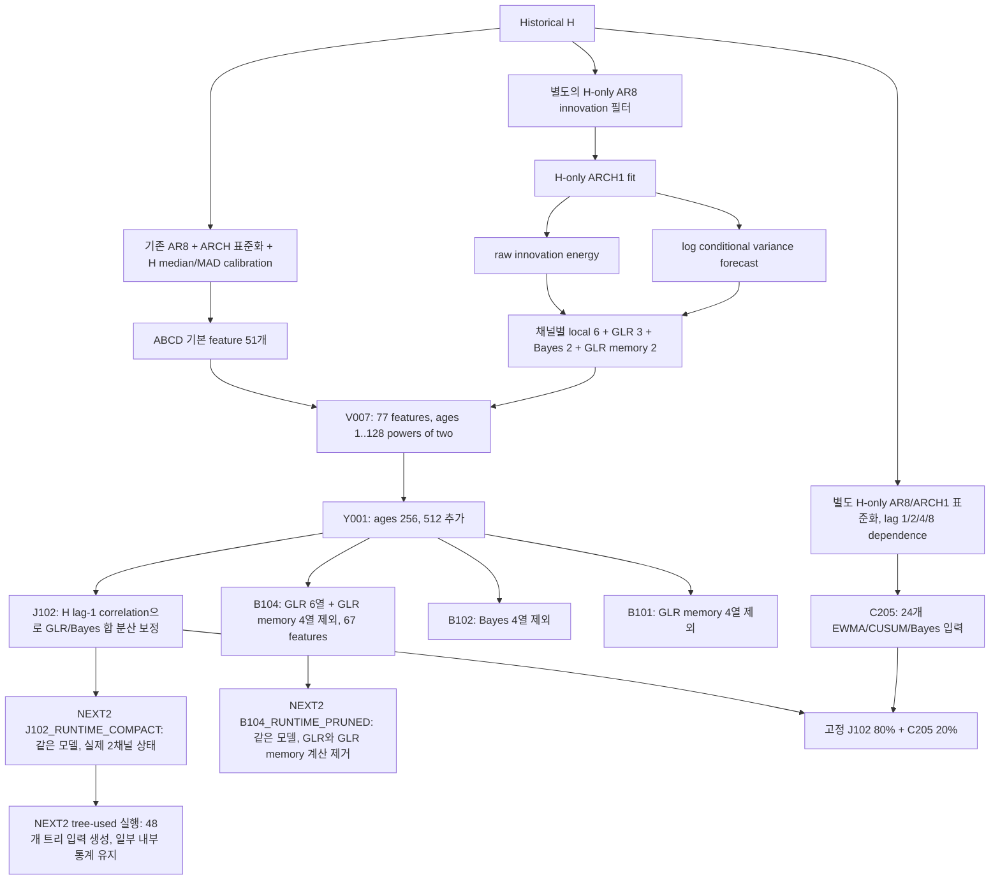

# NEXT2: 현재 generation의 실제 구성

이 문서는 기존 Python 소스와 동결된 experiment/model descriptor에서 복원했다. 해시 목록은 `artifacts/next2/initialization/FROZEN_REFERENCES.json`이다. 모델명만으로 구성이나 개선 원인을 추정하지 않는다.

기본 51열은 `src/next/design_selection.py`의 ABCD 선택을 통과한 `arch8__` 열이다. 새 variance bank의 AR8/ARCH1과 기본 feature의 AR8/ARCH 처리는 서로 다른 구현·정규화 계약을 갖는다. 이름이 비슷하다는 이유로 두 H fit을 합치면 exact parity가 깨질 수 있다.

`src/next/variance_evidence.py`는 6개 채널을 계산한다. 최종 J102/Y001/B104 모델은 앞의 raw energy와 log variance forecast 2개만 소비한다. raw energy는 `(e-H잔차평균)^2 / H stationary variance - 1`, forecast는 `log(predicted variance / H stationary variance)`다. ARCH parameter는 H에서 고정하고 O에서는 과거 squared innovation으로 상태만 갱신한다. forecast 계산은 현재 innovation을 조건부 상태에 넣기 전에 이루어진다.

`src/next/channel_evidence.py`의 13개 통계는 current, EWMA 8/32/128, positive/negative CUSUM, GLR max/logmean/logage, Bayes prior variance 0.25/1, cumulative GLR max/half-life 32 decayed GLR max다. H 채널 평균·표준편차로 표준화하고 온라인 값은 ±12로 제한한다. 따라서 'memory 없음'이라는 기존 B101 이름은 모든 기억을 없앴다는 뜻이 아니다. EWMA, CUSUM, 과거 age 합은 그대로 남는다.

age는 `[1,2,4,8,16,32,64,128,256,512]`이며 age마다 증분 구간 폭을 Bayes 혼합 가중치로 쓴다. prefix ring은 513개 위치를 갖는다. 온라인 길이나 tau는 이 계산에 들어가지 않는다.

`src/next/serial_channel_evidence.py`는 채널별 H lag-1 상관을 ±0.95로 제한하고 `v(n)=n+2 Σ(n-k)ρ^k`를 계산한다. GLR `S²/(2n)`의 분모를 v(n)으로 바꾸며 Bayes도 `S~N(nμ,v(n))`에 맞게 바꾼다. GLR에서 파생한 memory도 변한다. current/EWMA/CUSUM, H AR/ARCH fit은 같으므로 J102−Y001은 이 제한된 변경의 대응 비교다. 비정규·비선형 채널에 대한 근사 통계이며 유효한 e-process나 보정된 posterior라는 주장은 하지 않는다.

| 대응 비교 | 한 가지 변경 | 기존 5-fold 평균 효과 |
| --- | --- | ---: |
| Y001 − V007 | age 256/512 추가 | +0.002334211970588 |
| J102 − Y001 | serial GLR/Bayes 보정 | +0.000000280352155 |
| B104 − Y001 | explicit GLR와 GLR memory 열 제거 | −0.000142435253395 |
| B102 − Y001 | Bayes 열 제거 | −0.002774635454164 |

기존 비교를 다시 학습하지 않고 2,000회 paired whole-series bootstrap 배열로 재계산했다. `artifacts/next2/component_reuse/PAIRED_CONTRASTS.csv`는 parent 대비 attribution과 J102 대비 새 승격 기준을 구분한다. CI가 0을 포함한다는 사실만으로 비열등성이 입증되지는 않는다. B104의 J102 대비 비열등성 재표본 비율은 0.6255이고 Y001은 0.7800이므로, 현재 동결된 0.90 기준을 충족하지 못한다.

기존 `pruned_variance_runtime.py`와 `serial_variance_runtime.py`는 온라인 channel loop를 2개로 줄였지만 H에서 6개 채널을 계산하고 6개 채널의 배열을 할당했다. B104도 `channel_step`을 호출하여 필요 없는 GLR와 memory를 계산했다. 새 `src/next2/pruned_runtime.py`는 H 채널 생성부터 2개로 만들고, J102의 2채널 ring을 유지하며, B104에서는 GLR 최대·log-mixture·age-at-max·memory 배열과 계산을 실제로 제거한다. 최종 성능·state·속도 판정은 전체 DEV parity와 별도 타이밍 영수증 이후에 내린다.

새 대조 D2 explicit GLR 열 제거, D5 새 variance branch의 CUSUM 제거, D6 sparse age, D8 새 branch의 ARCH 제거, D10 conditional forecast 제거를 완료했다. D1/D3/D4/D7/D9/D11은 정확히 대응하는 기존 결과를 재사용했다. D9 forecast-only는 기존 screen 실패를 그대로 보존하며 전체 CV를 다시 실행하지 않았다. 자세한 parent 대비 효과와 J102 대비 승격 조건은 `artifacts/next2/component_effects/PAIRED_EFFECTS.csv`와 `PAIRED_BOOTSTRAP_NEXT2.csv`에서 구분한다.

D208의 ARCH 제거는 새 variance branch만 바꾼다. 이를 전체 ARCH 제거라고 해석하지 않도록 D218에서는 기본 ABCD와 새 variance branch 모두의 ARCH fitting/정규화를 제거했다. D218 평균은 0.6178936567835125이고 Y001 대비 효과는 −0.0037378131768125, 2,000회 conditional paired bootstrap CI는 [−0.0071544701969486, −0.0004607279498839]였다. 이 recipe 안에서 ARCH 기여를 뒷받침하는 대조이며 모든 DGP에서의 필요성을 뜻하지 않는다. D205 또한 ABCD의 CUSUM까지 제거한 실험은 아니다.

실제 실행부의 1차 축소는 J102/Y001/B104 모두에서 4,014,405개 DEV point의 선택 feature와 예측을 bitwise 보존했다. J102의 기존 배열 집계는 29,789→12,493 bytes다. 추가 `used_feature_runtime.py`는 학습된 트리의 분기에서 사용하지 않는 입력을 생략한다. all-DEV J102는 77개 과학적 feature 계약을 유지하면서 48개 입력을 만들고, 기존 ABCD EWMA cell은 51→31개로 줄인다. 전체 DEV에서 feature/예측이 일치했고, 별도로 5개 held-out fold 모델과 canonical 저장 형식을 거친 모든 OOF 예측도 일치했다. 새 형식은 학습된 트리·계수·분기 임계값을 바꾸지 않는다. 공유 selector를 분리한 실제 per-series numerical allocation 집계는 `artifacts/next2/numeric_memory/`에서 보고한다.

C205는 조건부 분산으로 표준화한 innovation의 lag 1/2/4/8 곱에 대한 증분 detector다. 각 lag마다 EWMA 8/32, 양·음 CUSUM, Bayes 0.25/1의 6개 입력만 사용한다. 새 실행부는 학습 feature에 없는 CDF 정렬, 128 EWMA, GLR와 memory를 실제로 계산하지 않는다. 단독 DEV 평균 0.5755159686249883과 J102 대비 within-time rank correlation 0.42193977197036003으로 고정 혼합 진입 조건을 충족했다.

J102/C205 80/20 혼합의 평균은 0.6232684128173095다. 원래 J102 대비 +0.0016366625048295이며, 독립 dependence 정보를 통한 개선이다. 모든 과학적 performance gate를 통과했지만 generation 기준 +0.0025/+0.0035에 도달하지 않았다. 합성 variance decrease와 단발성 이상치에서는 악화가 남는다. 따라서 이 결과를 전반적인 robustness 개선으로 표현하지 않는다. B104/C205를 같은 네 가중치로 혼합한 보조 대조의 최고 평균은 0.6229320415952054이며 고정 performance gain 기준을 실패했다.

실행 비용의 단독 측정 결과는 다음과 같다. 아래 상태 크기는 공유 selector·모델 배열을 제외한 시계열별 retained NumPy allocation이다. H 초기화는 고정된 128개 DEV 시계열의 중앙값이며, 10M은 H를 제외하고 직접 측정한 반복 버퍼 처리 시간이다. OS와 전력 상태는 별도로 통제하지 않았다.

| 실행 구현 | 점별 중앙값, µs | H 초기화 중앙값, µs | private 상태, bytes | 직접 10M, seconds |
| --- | ---: | ---: | ---: | ---: |
| J102 기존 | 5.1 | 7848.30 | 29173 | 51.6476629 |
| J102 compact | 5.2 | 7052.80 | 11877 | 51.6853034 |
| J102 tree-used | 5.1 | 4639.25 | 11729 | 50.7685899 |
| B104 기존 | 5.2 | 6817.80 | 28653 | 51.3303629 |
| B104 compact / B104_RUNTIME_PRUNED | 4.9 | 6805.40 | 11605 | 48.0586124 |
| B104 tree-used | 4.8 | 4628.25 | 11576 | 47.2147865 |
| J102/C205 80/20 compact | 10.4 | 8067.05 | 16933 | 104.597764 |

J102 tree-used의 48개는 트리에 전달하는 입력 수다. 그 안에는 기본 ABCD 25개와 새 분기 23개가 있다. 새 분기는 여전히 26개 내부 통계를 계산한 뒤 23개를 선택하므로 모든 내부 통계 계산량이 77→48로 줄었다고 해석해서는 안 된다. 실제로 줄어든 기본 ABCD EWMA cell은 51→31개다. 전체 4,014,405개 DEV 관측뿐 아니라 원래 5-fold OOF와 세 alternate split·H 구간 제외 검증의 모든 저장 예측에서도 동등성을 확인했다.

추가 J102 serial 항의 H-only 사전 계산은 예측을 보존하고 직접 10M 시간을 47.616355초로 줄였지만, tree-used 대비 개선율 약 6.21%는 사전 교체 기준 10%에 못 미쳤다. 상태는 1,200 bytes 늘어나므로 기존 tree-used를 유지한다. 실패한 교체 기준을 완화하지 않았으며 별도 진단 구현으로 보존한다.

후속 연구 `shared_blend_runtime.py`는 J102 새 분기와 C205에서 같은 AR8/ARCH1 추정과 온라인 상태 갱신을 공유한다. 기본 ABCD 분기는 계속 별도로 계산한다. 두 새 분기의 H 보정 replay에는 초기 분산의 부동소수점 계약 차이가 있어 이를 합치지 않는다. 전체 DEV, 원래 OOF, 모든 alternate/H holdout 예측과 실제 공개 API의 4,014,405개 출력까지 동등성을 확인했다. 공유 구현의 point median은 9.3 µs, H 초기화 median은 5140.05 µs, private state는 16,441 bytes, 직접 10M 처리는 93.1921636초다. 기존 80/20 compact 대비 직접 10M 약 10.90% 개선으로 사전 교체 기준을 통과했다. 최종 성능 entry는 `next2_shared_performance_main.py`이며, 별도 감사 단계의 새 환경·원본 DEV 재학습에서 canonical 모델 bytes와 전 DEV 예측의 동일성을 확인했다. 두 100-tree ensemble과 scientific prediction은 바뀌지 않았다. 전체 테스트 536개도 통과했다.

고정 합성 calibration H 4,000개를 재생한 추가 진단에서는 raw-energy H 표준편차 중앙값이 Gaussian/AR에서 약 1.434, ARCH에서 2.889, heavy-tail ARCH에서 3.175였다. 에너지 편차 제곱합에서 상위 1% 관측이 차지하는 비중 중앙값은 각각 약 28.8%, 28.9%, 73.1%, 75.3%다. `raw_energy >= -1`이므로 H 표준화 후 음의 순간 증거에는 정확한 하한 `(-1-H_mean)/H_sd`가 있다. 그 중앙값이 Gaussian 약 -0.710에서 ARCH -0.380, heavy-tail ARCH -0.354로 좁아진다. 이는 양·음 에너지 증거의 비대칭에 대한 해석이며, 트리 예측의 인과 효과나 forecast 채널의 무용성을 뜻하지 않는다. 자세한 한계와 limiting ARCH moment 계산은 `docs/NEXT2_SYNTHETIC_MOMENT_INTERPRETATION.md`, 고정 H 진단은 `artifacts/next2/h_calibration_asymmetry/`에 있다.
