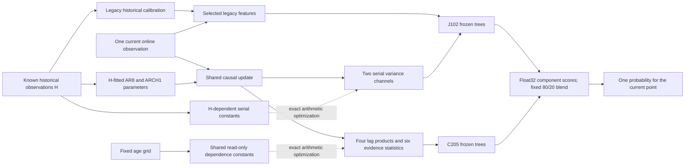
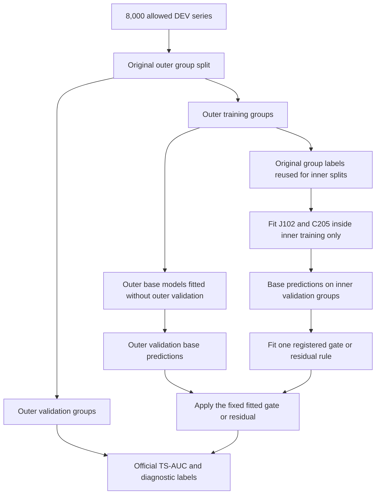

# Scientific model and runtime boundaries

The frozen 80/20 blend remains the performance reference. New scientific recipes are evaluated separately; no recipe has been promoted at this intermediate checkpoint. The exact runtime branch is a deployment implementation of the same scientific model.

There is no future-suffix, total online-length, dataset-ID or mechanism-label input to this graph. Training and post-outcome diagnostics can use labels and group identities under their separate DEV guards. The first public generator output is `None` before the dataset iterator is touched.

No outer-validation observation or target enters inner base training or meta-model fitting. The checkpoint audit reconstructs all 56 nested base-fit coordinate and target hashes. This prevents the specific stacking leakage under review; it does not undo earlier adaptive selection of the frozen base recipes on DEV.

For the final full-DEV R3 gate, all three leaves round to C205 weight 0.1. Its deployed behavior is therefore constant 90/10, despite being produced by a depth2 training procedure. The original outer-CV gates remain separately fitted, and their held-out scores are never replaced with scores from this full-DEV gate.
