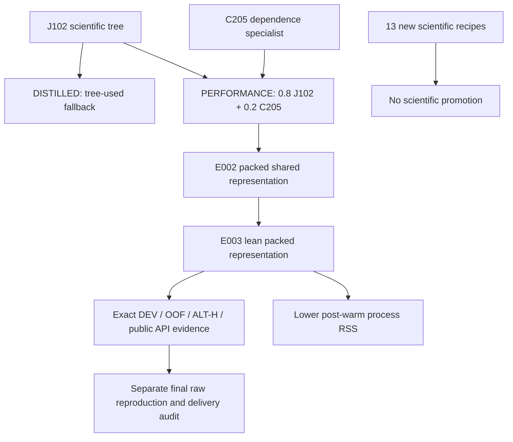

# NEXT3 근거 탐색 지도

과학 모델·진단·비용·전달 검증의 근거를 빠르게 찾기 위한 지도다. 아래 경로와 SHA는 실제 존재하는 완료 기록에서 읽었다. 새 학습이나 새 품질 평가를 수행하지 않았다. 과거 provisional/pending 기록은 원래 상태 그대로 보존한다. 현재 완료 여부는 root `DEV_CANDIDATES_NEXT3.json`, `FINAL_AUDIT_NEXT3.json`과 ZIP 생성 후의 외부 검증 receipt로 판단한다. 이 지도 생성 시각의 유지보수 snapshot을 최종 상태 선언으로 해석하지 않는다.

## 보존할 과학 역할

| 역할 | 고정 5-fold 평균 TS-AUC | canonical 모델 SHA256 |
|---|---:|---|
| FROZEN_DISTILLED | 0.62163175031248 | `27307b578f78bf4bcf11e8fb3011d34f82b14156eae7508b7514177cbc22b15d` |
| FROZEN_PERFORMANCE | 0.6232684128173095 | `1cdfcde2c715db69ab2bf91b8e9803ac1dd24a5e146bea8f94cbc7e16e7b1d90` |

E002/E003은 기존 PERFORMANCE의 표현과 실행 비용을 바꾼다. 선택 과학 예측의 시작 대비 Δ는 0이며 J102 대비 기존 blend 이득을 NEXT3의 새 이득으로 세지 않는다. 실제 fresh raw 재학습으로 생성한 최종 전달 모델 경로는 최종 root descriptor를 따른다.

## 바로 찾을 근거 25개

| 질문 | 실제 근거 | 해석 범위 |
|---|---|---|
| 시작 과학 모델과 고정 점수 | [science_reference](../artifacts/next3/preflight/FROZEN_REFERENCES.json) | NEXT2 과학 reference 복원; 이후 새 성능 향상을 뜻하지 않음 |
| 과학 역할 두 개 고정 | [role_freeze](../configs/next3/SCIENTIFIC_ROLE_FREEZE.json) | 새 과학 선택 종료; E003 최종 배포 승인은 별도 |
| 13개 새 recipe 종료 | [finite_menu](../artifacts/next3/bottlenecks/FINITE_MENU_CLOSURE_REVIEW.json) | 12 full + 1 screen 실패; 성능·강건성 승격 0 |
| 실패 후보와 재사용/보류 | [failure_index](../artifacts/next3/ledger/failure_index_v2_policy_schema/RESULTS.json) | 8개 사전 등록 항목, 원래 policy/source, 점수와 탈락 이유 |
| 닫힌 과학 표 | [closed_tables](../artifacts/next3/final_tables/prepared_v2/RESULTS.json) | 최종 publication 이전 준비본; 원래 ledger 213행 보존 |
| 등록과 실행 시각 | [recorded_chronology](../artifacts/next3/maintenance/registration_chronology/v1/RESULTS.json) | 172개 기록된 UTC chain; 없는 개별 완료 시각을 추정하지 않음 |
| 고정 scorer의 pair-mass 기여 | [pair_mass](../artifacts/next3/pair_contributions/RESULTS.json) | 조건부 mechanism AUC와 전체 점수 기여를 구분 |
| 감소 정보의 단계별 추적 | [scale_stages](../artifacts/next3/scale_stages/RESULTS.json) | 고정 합성쌍의 표현 진단; 새 winner가 아님 |
| router 확률 손실과 순위 목적 | [router_alignment](../artifacts/next3/router_metric_alignment/RESULTS.json) | 유한 fitted 후보의 목적 순서 차이; consistency 반례로 확대하지 않음 |
| 12개 후보 조건부 공동 envelope | [conditional_envelope](../artifacts/next3/selection_uncertainty/RESULTS.json) | 적응적 선택 보정이나 새로운 독립 검증이 아님 |
| 다른 scorer 계산으로 재구성 | [pair_matrix](../artifacts/next3/pair_matrix_audit/run_v1/RESULTS.json) | 130,065개 score 계산; numeric independence와 generalization 분리 |
| 이상치 coarse 상태 교체 | [outlier_coarse](../artifacts/next3/outlier_state_transfer/run_v1/RESULTS.json) | 고정 합성 counterfactual; 도달 가능성·비가산성 한계 유지 |
| legacy EWMA 묶음의 잔류 | [outlier_fine](../artifacts/next3/legacy_state_transfer/run_v1/RESULTS.json) | EWMA160 단일 cell의 원인이나 배포 reset 효과로 단정하지 않음 |
| E003 비용 gate | [e003_decision](../artifacts/next3/engineering/lean_shared/ENGINEERING_GATE_DECISION.json) | memory 경로 통과; startup 20%·throughput 향상 주장은 없음 |
| E003 all-DEV exact | [e003_all_dev](../artifacts/next3/engineering/lean_shared/all_dev/RESULTS.json) | 8,000 DEV / 4,014,405점; 품질 점수의 새로운 독립 검증이 아님 |
| E003 OOF exact | [e003_oof](../artifacts/next3/engineering/lean_shared/heldout_metadata_corrected_v1/oof/RESULTS.json) | 보존된 과거 CV 모델의 사용하지 않는 metadata 빈값만 validation helper에서 처리 |
| E003 ALT/H exact | [e003_alt_h](../artifacts/next3/engineering/lean_shared/heldout_metadata_corrected_v1/alternate/RESULTS.json) | 20개 기존 모델 / variant당 16,057,620점; 새 ALT/H fit 0 |
| fresh process RSS와 초기 None | [e003_cold](../artifacts/next3/engineering/lean_shared/cold/RESULTS.json) | 중앙값 RSS의 비율과 중앙값 준비 시간의 비율; process spawn 전체 시간과 다름 |
| paired direct 10M | [e003_direct](../artifacts/next3/engineering/lean_shared/direct/RESULTS.json) | 세 paired 시간 비율의 중앙값; 총 60M; 속도 향상으로 해석하지 않음 |
| E003 실제 public API | [e003_public](../artifacts/next3/lean_public_api_all_dev/RESULTS.json) | all-DEV current-point 추론과 역순 128개 reset 검증 |
| 원래 긴 합성 예측과 비교 | [long_original](../artifacts/next3/maintenance/lean_long_horizon_parity_v1/RESULTS.json) | 34,603,008점 exact; 새 threshold·FPR·품질 개선 없음 |
| 예측 배열 없는 복사본 장기 재생 | [long_copy](../artifacts/next3/maintenance/long_horizon_copy_replay_v1/RESULTS.json) | 실제 선택 CLI 실행; 기존 고정 환경; 최종 ZIP 검증과 별도 |
| 고정 horizon 보정의 해석 | [horizon_scope](../artifacts/next3/maintenance/horizon_calibration_logic_v1/RESULTS.json) | 1,024점 보정을 무한 horizon·특정 H 조건부 보장으로 확대하지 않음 |
| 복사된 public entry 초기 동작 | [copied_entry_smoke](../artifacts/next3/maintenance/raw_input_copy_smoke_v2_entry_first/RESULTS.json) | 빈 train 거부와 초기 None만 검증; 실제 raw 재학습은 별도 |
| 기존 바탕화면 전달물 보존 | [previous_desktop](../artifacts/next3/maintenance/old_desktop_preservation_maintenance_v1/RESULTS.json) | 이전 ZIP과 20개 파일; 새 전달물은 별도 이름과 검증 receipt |

## 최종 전달의 authority 순서

1. `00_GPT_READ_FIRST_NEXT3.md`와 `01_GPT_HANDOFF_NEXT3.md`: 최종 한국어 설명과 실행 명령.
2. `DEV_CANDIDATES_NEXT3.json`과 `DEPLOYMENT_ENTRY_POINTS_NEXT3.json`: 선택 역할과 실제 모델·entry 경로.
3. `FINAL_AUDIT_NEXT3.json`: 별도 최종 감사 기간에 검증한 source·raw 재학습·전체 테스트·runtime·보고서 근거.
4. `SOURCE_MANIFEST_NEXT3.json`: 실제 packaging에 포함한 파일의 SHA와 크기. archive 자기 자신의 최종 SHA를 내부에 재귀적으로 넣지 않는다.
5. ZIP 생성 후 프로젝트의 `artifacts/next3/handoff/DESKTOP_ZIP_VERIFICATION_NEXT3.json` 및 바탕화면 20개 폴더의 동일 외부 receipt: 실제 archive CRC/SHA, 압축 해제 재생, 문서 명령 검증.
6. 프로젝트의 `artifacts/next3/handoff/SESSION_COMPLETION.json`: 새 ZIP과 정확히 20개 파일, 이전 전달물 보존을 모두 확인한 최종 종료 시각. 이 사후 기록을 그보다 앞서 생성한 ZIP 내부에 있다고 주장하지 않는다.

raw·real point OOF·환경·wheel cache는 ZIP에서 제외한다. 필요한 raw SHA는 `RAW_DATA_REQUIRED_NEXT3.json`을 따른다. JSON의 모든 참조 파일이 ZIP에 들어 있다는 뜻은 아니므로 hash 목록을 원본 데이터의 포함 목록으로 해석하지 않는다.
