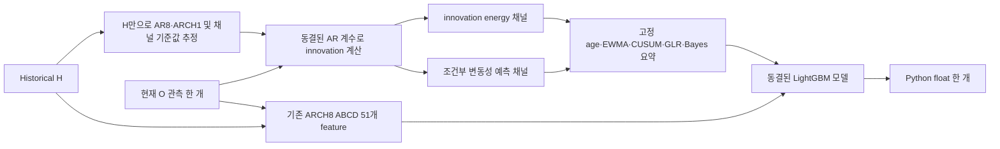

# 최종 감사 보충 문서

기본 결과는 루트의 `00_GPT_READ_FIRST_NEXT.md`와 `01_GPT_HANDOFF_NEXT.md`에 있다. 이 문서는 그 결과를 바꾸지 않고 추가 감사에서 확인한 실행·전달 문제와 재현 방법을 정리한다. 전체 감사의 최종 시간과 상태는 `artifacts/next/final_audit/RESULTS.json`을 기준으로 확인한다.

## 최종 모델의 입력 구조



AR/ARCH 파라미터의 추정은 H에서 끝난다. 온라인에서는 고정된 재귀식의 상태가 갱신된다. 구조 변화 요약의 값이 크다는 사실과 배포 가능한 경보 임계값이 있다는 사실은 다르다.

| 역할 | 최종 후보 | 입력 열 | 나이 격자 최대 | 나무 수 | 점당 중앙값 | H 포함 평균 비용 | 온라인 상태 배열 |
| --- | --- | --- | --- | --- | --- | --- | --- |
| PRIMARY | J102_SERIAL_VARIANCE_512 | 77 | 512 | 100 | 7.7 μs | 28.394 μs/point | 29,789 bytes |
| ROBUST | B104_LONG_VARIANCE_NO_GLR_MEMORY | 67 | 512 | 100 | 7.9 μs | 33.777 μs/point | 29,189 bytes |
| FAST | F101_VARIANCE_TREES50 | 77 | 128 | 50 | 6.7 μs | 25.636 μs/point | 10,845 bytes |

J102는 GLR/Bayes의 합 분산에 H 상관 보정을 적용한다. B104는 explicit GLR 및 그 memory의 10개 입력 열을 제거했지만, runtime 안에서 해당 계산을 완전히 제거한 것은 아니다. FAST는 F201보다 품질이 높아서 선택된 것이 아니라, 미리 정한 FAST 판정에서 측정된 점당 중앙값이 작았기 때문에 선택됐다. 속도 수치는 파일·소켓·클라우드 비용을 포함하지 않는다. 상태 배열 크기는 전체 프로세스 RSS가 아니다.

## 추가 감사에서 확인한 결과

선정 후 실제 train 인터페이스를 통해 세 모델을 각각 다시 만들었다. 각 모델의 파일 바이트는 기존 cache 기반 all-DEV fit 및 별도 raw 재현의 결과와 일치했다. 전체 DEV 8,000개와 opaque seal ID 2,000개의 처리를 검사했으며 실제 sealed 관측이나 target은 제공하지 않았다.

최종 후보의 원본 15개 fold는 변경하지 않은 공식 채점기, 직접 rank 계산, 정렬된 frame 계산, 독립적으로 섞은 frame의 정렬 후 계산에서 모두 같은 점수를 냈다. 최대 절대 차이는 0이었다. 재학습 또는 새로운 평가 집합을 사용한 점수 비교가 아니다.

최종 CSV의 후보 142개, screen/full/stress CV 1,009개 셀, paired 절단 648개를 원본 결과와 대조했다. screen과 전체 5-fold 점수를 구분하고, N013의 잘못된 baseline 점수는 원본 품질 판정에서 제외한 상태를 유지했다.

새로 설치한 63개 고정 의존성 환경에서 전달 파일만 복사한 폴더를 실행했다. 세 후보의 총 53,313개 확인 지점이 기존 예측과 정확히 일치했다. 프로젝트 모듈은 복사된 payload에서만 로드됐고 원래 프로젝트 접근 시도는 0이었다. 추론의 readiness, single-pass, 미래 관측을 미리 읽지 않는 조건과 read-only 계약도 검사했다. 이 검증은 Python 감사 hook 경계이며 OS sandbox 증명은 아니다.

같은 새 환경에서 전체 테스트 **350개가 통과**했다. 실패·오류·skip은 각각 0이며 실행 중 source hash가 바뀌지 않았다. 추가된 수식 검증은 nonzero serial correlation에서 Bayes 요약이 명시된 Gaussian 평균 사전 적분과 일치하는지 독립 수치 적분으로 확인했다. 실제 채널의 Gaussian성이나 경보의 time-uniform 보장을 입증한 테스트는 아니다.

## 전달 검사에서 발견해 수정한 두 문제

첫 복사 시도는 재현 폴더의 긴 경로 때문에 Windows WinError 206으로 중단됐다. 경로가 짧은 새 폴더를 사용하고, 복사 전에 최대 경로 길이를 검사하도록 고쳤다. 부분 복사본은 `artifacts/next/portable_workspaces/final_v1`에 남아 있으며 ZIP에는 포함하지 않는다.

GPT에 전달할 때는 ZIP을 그대로 업로드하면 된다. Windows에서 직접 풀 경우에는 긴 ZIP 이름과 같은 폴더명 대신 `C:\Users\minsu\Documents\SB_NEXT`처럼 짧은 경로를 사용한다. 가장 긴 ZIP 내부 상대 경로는 170자라서 상위 폴더 이름까지 길면 기본 경로 제한을 넘을 수 있다.

두 번째 시도에서는 기존 feature 모듈이 import 때 읽는 `configs/features.json` 등이 포장 목록에서 빠져 있었다. 기존 JSON 설정을 포함하도록 수정했다. 이전 실패 영수증과 당시 driver는 `artifacts/next/portable_delivery_attempt_2`에, 실패한 복사본과 환경은 `.next-portable-v2`에 보존했다. 후자의 환경과 원시 fixture는 ZIP에 포함하지 않는다. 수정 후 `.next-portable-v3`의 새 환경과 복사본이 통과했다.

학습·추론의 과학적 구현이나 모델 파일을 이 복구 과정에서 변경하지 않았다. 이전의 테스트 통과만으로 전달 패키지가 독립 실행된다고 가정하면 발견할 수 없었던 포장 의존성 문제였다.

## GPT가 원시 데이터 없이 다시 확인할 수 있는 것

최종 ZIP의 파일 집합·크기·CRC·SHA256은 다음 명령으로 확인한다. Python 표준 라이브러리만 필요하다.

```text
python scripts/verify_next_handoff_manifest.py "전달받은 ZIP 경로"
```

최종 후보 세 개의 24개 절단별 paired CI를 다시 요약하는 데 필요한 기존 reference 통계를 작은 CSV로 추가했다. 후보 통계는 이미 포함된 작은 NPY 파일을 사용한다. 원시 값, 라벨, dataset ID, point별 OOF가 필요하지 않다.

```text
python artifacts/next/portable_bootstrap_replay/replay.py --output replay_result.json
```

72개 비교의 평균·중앙값 차이, CI와 양수 비율이 원본 forensic CSV와 **차이 0**으로 일치했다. 필요한 366개 파일만 별도 폴더에 복사하고 원래 프로젝트 접근을 차단한 재실행도 통과했다. `artifacts/next/portable_bootstrap_replay/COPIED_REPLAY.json`에 기록했다. 같은 기존 통계를 다시 요약했으므로 독립 성능 검증이나 새 bootstrap 실험은 아니다.

추가로 먼저 읽기 문서의 핵심 숫자 25개를 원본 수치와 표시 정밀도까지 대조했다. 근거는 `artifacts/next/narrative_audit/CLAIM_PROVENANCE.csv`다. H 진단의 AR4 절대 ACF1은 정확히 0.04801547230468006이며, 먼저 읽기의 0.04801은 마지막 자리에서 잘라 표시한 값이다. 소수점 다섯 자리로 반올림하면 0.04802다. 정밀 계산에는 원본 H 요약 CSV를 사용한다.

원본 Python 소스, 선택한 모델 가중치, 최종 CSV 및 이전 champion은 보존했다. 새 연구를 이어가기 전에 장기 오경보와 합성 scale 감소 반례, J102/Y001의 사실상 동률, 적응적 DEV 선택 편향을 함께 검토한다.
